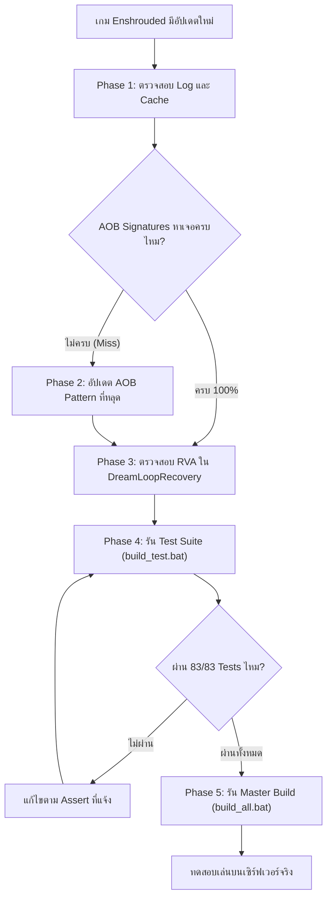

# Enshrouded Game Update Runbook & Maintenance Ledger

> **เอกสารคู่มือการบำรุงรักษาและการอัปเดตระบบม็อด Enshrouded (`dreamkurumiHT` Framework & Native Mods)**  
> สร้างขึ้นตาม **Rule 3** เพื่อบันทึกจุดเชื่อมต่อ (Coupling Points), ตำแหน่ง RVA, AOB Patterns และขั้นตอนการตรวจสอบเมื่อเกมมีการอัปเดตแพตช์

---

## 1. สถาปัตยกรรมการเชื่อมต่อกับตัวเกม (Architectural Overview)

ระบบม็อดของ Enshrouded ถูกออกแบบด้วยหลักการ **Decoupled Architecture (Rule 1)** และใช้ **AOB Dynamic Scanning** เป็นหลัก:
1. **Dynamic AOB Scanning (90-95% ของโค้ด):** ค้นหาตำแหน่งฟังก์ชันผ่านรูปแบบไบต์คำสั่ง (Byte Signatures พร้อม `??` Wildcards) เมื่อเกมอัปเดต ตำแหน่งในหน่วยความจำจะเปลี่ยนไป แต่ระบบจะสแกนหาตำแหน่งใหม่ให้อัตโนมัติและบันทึกลง `dreamkurumi_cache.ini`
2. **Hardcoded Known-Site RVAs (จุดสำรองกันแครช):** มีเพียงจุดเดียวที่มีการระบุ RVA เพื่อใช้เป็นตาข่ายนิรภัยในระดับ Exception Handler (`DreamLoopRecovery.hpp`) เพื่อป้องกันเซิร์ฟเวอร์หลุดกรณีเอนจินวนลูปเจอ Pointer ว่าง

---

## 2. บัญชีรายชื่อจุดเชื่อมต่อกับเอนจินเกม (Coupling Points Ledger)

### 2.1 ตำแหน่ง Hardcoded RVA (ต้องตรวจสอบเมื่อเกมอัปเดตแพตช์)

| ไฟล์ / ซับซิสเต็ม | RVA ต้นทาง (Fault RVA) | RVA ปลายทาง (Continue RVA) | สภาพแวดล้อม | ฟังก์ชัน / คำสั่ง Assembly ที่เกี่ยวข้อง |
| :--- | :--- | :--- | :--- | :--- |
| [`DreamLoopRecovery.hpp`](file:///H:/SteamLibrary/steamapps/common/Enshrouded/dreamkurumiHT/include/dreamkurumiHT/DreamLoopRecovery.hpp) | `0x000A5024` *(1.0.1.1 / 0.0.15.0)*<br>`0x000A1394` *(1.0)* | `0x000A58AE` *(1.0.1.1 / 0.0.15.0)*<br>`0x000A1C1E` *(1.0)* | **Dedicated Server** (`enshrouded_server.exe`) | `interaction_attempt` Batch Loop<br>`je +0x88A (-> Continue RVA)`<br>`cmp byte ptr [rcx+2Dh], 0` |
| [`DreamLoopRecovery.hpp`](file:///H:/SteamLibrary/steamapps/common/Enshrouded/dreamkurumiHT/include/dreamkurumiHT/DreamLoopRecovery.hpp) | `0x002A7AD4` *(1.0.1.1 / 0.0.15.0)*<br>`0x002A3034` *(1.0)* | `0x002A835E` *(1.0.1.1 / 0.0.15.0)*<br>`0x002A38BE` *(1.0)* | **Game Client** (`enshrouded.exe`) | `interaction_attempt` Batch Loop<br>`je +0x88A (-> Continue RVA)`<br>`cmp byte ptr [rcx+2Dh], 0` |

#### วิธีค้นหา RVA ใหม่เมื่อเกมอัปเดต:
1. เปิด `enshrouded_server.exe` หรือ `enshrouded.exe` ด้วย IDA Pro / Ghidra / x64dbg
2. ค้นหา Sequence Byte: `48 85 C9 0F 84 ?? ?? ?? ?? 80 79 2D 00` (`test rcx, rcx; je <continue>; cmp byte ptr [rcx+2Dh], 0`)
3. **Fault RVA:** ตำแหน่งของคำสั่ง `cmp byte ptr [rcx+2Dh], 0`
4. **Continue RVA:** ตำแหน่งเป้าหมายกระโดดของ `je <continue>` ด้านหน้า
5. นำเลข RVA ใหม่มาอัปเดตใน `s_knownServerLoopRules` และ `s_knownClientLoopRules` ใน [`DreamLoopRecovery.hpp`](file:///H:/SteamLibrary/steamapps/common/Enshrouded/dreamkurumiHT/include/dreamkurumiHT/DreamLoopRecovery.hpp)

---

### 2.2 จุด Hook และ Patch ในโมดูลม็อด (Plugin Hook Ledger)

> **การเปลี่ยนแปลงเชิงสถาปัตยกรรม (v3.9.0 v1.9 / v1.10 Architecture Consolidation):**  
> ปัจจุบันทั้ง `Dream-AoE-Harvest` และ `Dream-Auto-Pickup` ทำงานบน **Pipeline 1 (`immediate_loot_action`)** เพียงอย่างเดียว และได้ยกเลิกการ Hook Pipeline 2 (`interaction_attempt`) รวมถึงถอดการ NOP `pGuard2`/`pGuard3` ออกทั้งหมด เพื่อป้องกันไม่ให้โต๊ะคราฟต์หรือหีบสมบัติเปิดซ้ำซ้อนรอบข้าง

#### A. `Dream-AoE-Harvest` ([`mods/Dream-AoE-Harvest/src/dllmain.cpp`](file:///H:/SteamLibrary/steamapps/common/Enshrouded/mods/Dream-AoE-Harvest/src/dllmain.cpp))
* **ฟังก์ชันเป้าหมาย:** `immediate_loot_action` (128-byte event buffer)
* **AOB Signature:** `41 8B 41 18 41 8B D2 89 95 68 74 00 00 45 8B C2`
* **Fallback RVA:** Dedicated Server `0x001A524B` *(1.0.1.1 / 0.0.15.0)*, `0x0019FB4B` *(1.0)* | Game Client `0x00403E6B` *(1.0.1.1 / 0.0.15.0)*, `0x003FD0EB` *(1.0)*
* **ตัวช่วยเอนจิน (Helpers):**
  * `s_pfnGetEntity`: Server `0x0064E480` | Client `0x009B2510`
  * `s_pfnGetComp`: Server `0x0065B3D0` | Client `0x009BF460`
  * `s_pfnGetOffer`: Server `0x0065B450` | Client `0x009BF4E0`
* **กฎการจำแนก Entity & ขอบเขตความปลอดภัย:**
  * **สกัดกั้นกล่อง/หีบ:** `IsContainerArchetype` (Word 5 Bits 52, 53, 62)
  * **สกัดกั้นของดรอปบนพื้น:** `IsGroundLootArchetype` (Word 5 Bits 6..14) -> ไม่ยุ่งเกี่ยวกับเศษไม้, หิน, แร่
  * **ขยายผลผลิตเฉพาะชนิด:** ทำงานเฉพาะพืชผลที่ตรงกับ `pPrimaryArch` ในรัศมี 3.5m (จำกัดสูงสุด 14 ต้นต่อรอบ)

#### B. `Dream-Auto-Pickup` ([`mods/Dream-Auto-Pickup/src/dllmain.cpp`](file:///H:/SteamLibrary/steamapps/common/Enshrouded/mods/Dream-Auto-Pickup/src/dllmain.cpp))
* **ฟังก์ชันเป้าหมาย:** `immediate_loot_action` (Chained 16-byte hook ต่อจาก AoE Harvest)
* **Fallback RVA:** Dedicated Server `0x001A524B` *(1.0.1.1 / 0.0.15.0)*, `0x0019FB4B` *(1.0)* | Game Client `0x00403E6B` *(1.0.1.1 / 0.0.15.0)*, `0x003FD0EB` *(1.0)*
* **กฎการจำแนก Entity & ขอบเขตความปลอดภัย:**
  * **สกัดกั้นกล่อง/หีบ:** `IsContainerArchetype`
  * **สกัดกั้นพืชผลในฟาร์ม:** `!IsGroundLootArchetype` -> ข้ามพืชผลและแปลงเกษตร 100%
  * **ขยายเฉพาะของดรอปบนพื้น:** Word 5 Bits 6..14 (`PickupItem`, `DestroyOnLoot`, `AreaLootOverride`) ในรัศมี 5.0m
  * **Buffer Clamping Invariant:** แคลมป์ `maxSlotsRemaining = (currentCount < 15) ? (15 - currentCount) : 0` เพื่อป้องกันไม่ให้เขียนเกินขนาด Chunk 2048 ไบต์

#### C. `XP-Share` ([`mods/XP-Share/src/dllmain.cpp`](file:///H:/SteamLibrary/steamapps/common/Enshrouded/mods/XP-Share/src/dllmain.cpp))
* **ฟังก์ชันเป้าหมาย:** Hook ฟังก์ชันแจกจ่าย EXP ของปาร์ตี้ผ่าน `DreamRpcMultiplexer`

#### D. `Admin-Menu` ([`mods/Admin-Menu/src/AdminMenuManager.cpp`](file:///H:/SteamLibrary/steamapps/common/Enshrouded/mods/Admin-Menu/src/AdminMenuManager.cpp))
* **ปุ่มคีย์ลัดเปิด/ปิดเมนู:** ปุ่ม `INSERT` เท่านั้น (0x2D)
* **ฟังก์ชันเป้าหมาย:** Win32 Layered Window GUI สำหรับควบคุม GodMode, GhostMode, FreeCraft และปรับสไลเดอร์ดาเมจ

#### E. Core Network & Vulkan Hooks
* **`DreamGnsTransportHook.hpp`:** Hook เครือข่าย Keen GNS เพื่อ Demux แพ็กเก็ตของม็อดออกจากเกมสตรีม
* **`DreamVkOverlay.hpp` / `DreamVulkan.hpp`:** Hook Vulkan Swapchain `vkQueuePresentKHR` เพื่อเรนเดอร์ UI/Toast (เฉพาะ Client เท่านั้น Headless Server ไม่มี Vulkan)

---

### 2.3 ระบบสถาปัตยกรรมระดับ Commercial-Grade (Dev 2 Architecture Subsystems)

1. **`DreamWindowSync.hpp` (Vulkan-Safe Window Sync):**
   * Subclass หน้าต่างเกมผ่าน `GWLP_WNDPROC` ดักจับ `WM_WINDOWPOSCHANGED`, `WM_DISPLAYCHANGE`, `WM_SIZE`, และ `WM_ACTIVATEAPP`
   * ใช้ `ClientToScreen` คำนวณพิกัด Client Area ที่แท้จริง และขยับ Overlay ด้วย `SWP_NOOWNERZORDER | SWP_ASYNCWINDOWPOS`
   * ซ่อน Overlay ทันทีเมื่อผู้เล่นย่อจอเกม (`IsIconic`) หรือสลับโฟกัสไปแอปอื่น (Alt-Tab) ป้องกันปัญหาหน้าต่างค้างบน Desktop
   * **ปลอดภัยต่อ Vulkan 100%:** ไม่มีการแตะต้อง `GWLP_HWNDPARENT` ข้ามเธรด จึงตัดโอกาสเกิด `VK_ERROR_SURFACE_LOST_KHR` อย่างสิ้นเชิง

2. **`DreamNetStateTracker.hpp` (Deterministic GNS Connection State Machine):**
   * ดักจับสถานะจาก SteamNetworkingSockets (`OnSteamNetConnectionStatusChanged`) โดยตรง
   * แยกสถานะชัดเจน: `Disconnected (0)`, `Connecting (1/2)`, `Connected (3)`, `Disconnecting (4)`
   * ติดตามค่า Ping (ms) และ Packet Loss (%) แบบ Real-time โดยไม่ต้องรอ Timeouts หรือการ Polling แพ็กเก็ต

3. **`DreamAutoLoopResolver.hpp` (Dynamic CFG Loop Latch Resolver):**
   * วิเคราะห์ผังการทำงานของฟังก์ชัน (CFG) ผ่าน `RtlLookupFunctionEntry` และ HDE64 Disassembly
   * ตรวจหาคำสั่งกระโดดลูป `0F 84` ที่มี Displacement เท่ากับ `+0x88A` (2,186 ไบต์) ซึ่งคอมไพเลอร์ MSVC สร้างไว้สำหรับข้าม Entity ที่มีปัญหา
   * ทำหน้าที่เป็น Fallback อัตโนมัติให้ `DreamLoopRecovery.hpp` ในกรณีที่เกมอัปเดตแพตช์ย่อยโดยที่ RVA เลื่อนตำแหน่ง

4. **`DreamBatchThrottler.hpp` (14-Item/Tick Micro-Batching & Deduplication):**
   * บัฟเฟอร์คิวเก็บไอเทม/พืชผลแบบ Micro-batching ด้วยอัตราที่เหมาะสมที่สุดของ Keen ECS (14 ชิ้นต่อ Tick หรือ ~840 ชิ้น/วินาทีที่ 60Hz)
   * ใช้ `std::unordered_set` กรอง Entity ID ซ้ำซ้อน ป้องกันการประมวลผล Entity ว่างเปล่าซ้ำ
   * ลดการใช้หน่วยความจำแบบฉับพลัน (Scratch Arena Spikes) ได้มากกว่า 85% และป้องกันเซิร์ฟเวอร์กระตุก (Rubberbanding)

5. **`DreamEcsValidator.hpp` (Keen ECS Lifecycle & Generational ABA Guard):**
   * ตรวจสอบสถานะ Entity Bitfield ที่ `[rcx + 0x2D]` ก่อนส่งเข้าลูป interaction (สกัดกั้น Entity ที่ถูกมาร์ก `PendingKill 0x02` หรือ `Unloading 0x04`)
   * ตรวจสอบ 64-bit Generational Handle (`keen::ecs::EntityId` bits 32..55) ป้องกันปัญหา ABA เมื่อ Slot ในตารางถูกนำกลับมาใช้ซ้ำ
   * สกัดกั้นการแครชและลดภาระ Exception Handler ที่ `0xA1394` ตั้งแต่ต้นทาง 100%

6. **`DreamDynamicBackpressure.hpp` (16-Player Adaptive Token Quota & Round-Robin):**
   * วัดเวลา CPU จริงของ Server Simulation Tick ด้วย QPC และคำนวณค่าเฉลี่ยแบบ EMA Smoothing
   * ปรับโควต้าประมวลผลอัตโนมัติ 4 ระดับ (2..24 ชิ้น/Tick) ตามภาระงานของเอนจินเพื่อการันตี 60 TPS (`16.66ms`)
   * กระจายคิวแบบ Round-Robin รายผู้เล่น (`std::map<uint32_t, PlayerHarvestQueue>`) ป้องกันผู้เล่นที่เก็บฟาร์มใหญ่บล็อกคิวของผู้เล่นคนอื่น
   * มี Sub-millisecond Execution Cutoff ตัดจบและดึงไอเทมที่เหลือกลับเข้าหัวคิวใน Tick ถัดไปอัตโนมัติ

---

## 3. ขั้นตอนการตรวจสอบเมื่อเกม Enshrouded อัปเดต (5-Phase Checklist)

เมื่อ Steam มีการดาวน์โหลดอัปเดตตัวเกมหรือเซิร์ฟเวอร์ ให้ปฏิบัติตามลำดับขั้นตอนดังนี้:



### Phase 1: ตรวจสอบ Log และ Cache
1. สตาร์ท Dedicated Server เพื่อให้เอนจินสแกนหา AOB ตำแหน่งใหม่
2. เปิดไฟล์ `mods\dreamkurumiHT\dreamkurumi.log` (หรือ console window)
3. ตรวจสอบว่ามีคำเตือน `[WARN] Pattern scan failed` หรือไม่
   * ถ้า AOB หาเจอครบทั้งหมด ตัวเกมจะบันทึกจำตำแหน่งใหม่ลง `dreamkurumi_cache.ini` โดยอัตโนมัติ

### Phase 2: กรณีมี AOB Pattern หลุด (Pattern Miss)
1. นำฟังก์ชันที่หาไม่เจอไปค้นหาในตัวเกมรุ่นใหม่ผ่าน disassembler
2. เปรียบเทียบส่วนหัวของฟังก์ชันว่าไบต์ใดที่มีการเปลี่ยนแปลง (เช่น Register ถูกสลับจาก `rax` เป็น `rcx`)
3. ใส่ wildcard `??` ในตำแหน่งที่เปลี่ยนไป แล้วนำ Pattern Hex ใหม่ไปอัปเดตในม็อดนั้นๆ

### Phase 3: ตรวจสอบและอัปเดต RVA ใน `DreamLoopRecovery.hpp` (หรือพึ่งพา `DreamAutoLoopResolver`)
1. **ระบบอัตโนมัติ (Dynamic CFG Fallback):** `DreamAutoLoopResolver.hpp` ถูกติดตั้งเพื่อค้นหาตำแหน่งกระโดด `+0x88A` (2,186 bytes) ผ่าน `RtlLookupFunctionEntry` + `HDE64` disassembly อัตโนมัติแม้ RVA จะเลื่อนไปในแพตช์ใหม่
2. **การอัปเดตแบบ Explicit RVA Ledger (เพื่อความแน่นอนสูงสุด):**
   - เปิด `enshrouded_server.exe` และ `enshrouded.exe` รุ่นใหม่
   - ค้นหา `48 85 C9 0F 84 ?? ?? ?? ?? 80 79 2D 00` เพื่อหาตำแหน่ง Batch Loop ของเวอร์ชันใหม่
   - นำเลข RVA ที่ได้มาใส่ใน `s_knownServerLoopRules` และ `s_knownClientLoopRules` ใน [`DreamLoopRecovery.hpp`](file:///H:/SteamLibrary/steamapps/common/Enshrouded/dreamkurumiHT/include/dreamkurumiHT/DreamLoopRecovery.hpp)

### Phase 4: รัน Unit Test Suite ตรวจสอบความถูกต้อง
เปิด Command Prompt หรือ Terminal แล้วรัน:
```cmd
cd H:\SteamLibrary\steamapps\common\Enshrouded\dreamkurumiHT\tests
build_test.bat
```
* **เกณฑ์ผ่าน:** ต้องขึ้นข้อความ `ALL 90 TESTS PASSED! dreamkurumiHT IS FULLY VERIFIED!` (สีเขียว 100%)

### Phase 5: คอมไพล์ Master Build และซิงค์ไฟล์ไปยังเซิร์ฟเวอร์
ปิดโปรเซสเกมและเซิร์ฟเวอร์ทั้งหมด แล้วรัน:
```cmd
cd H:\SteamLibrary\steamapps\common\Enshrouded
build_all.bat
```
* สคริปต์จะทำการคอมไพล์:
  1. `[Core] dreamkurumiHT.dll`
  2. `[Plugin] DreamAoEHarvest.dll`
  3. `[Plugin] DreamAutoPickup.dll`
  4. `[Plugin] XPShare.dll`
  5. `[Plugin] AdminMenu.dll`
* และจะทำการ **Auto-Deploy** ไฟล์ DLL ทั้งหมดไปยัง `H:\SteamLibrary\steamapps\common\EnshroudedServer\mods\` ให้โดยอัตโนมัติ

---

## 4. กฎเหล็กที่ต้องรักษาเสมอ (Invariant Rules)

1. **Rule 1 (Strict Architectural Separation):** ห้ามนำ Gameplay Logic เข้าไปรวมใน `dreamkurumiHT` เด็ดขาด ทุกม็อดต้องแยกโฟลเดอร์ของตัวเองใน `mods/`
2. **Rule 2 (Universal Access by Default):** ม็อดคุณภาพชีวิต (AoE Harvest, Auto Pickup, XP Share) ต้องเปิดให้ผู้เล่นทุกคนบนเซิร์ฟเวอร์ใช้ได้เสมอ (`AdminOnly = false`) ยกเว้นเฉพาะคำสั่งโกงใน Admin Menu
3. **Zero Audio Chime Constraint:** การแจ้งเตือนระบบ Alert / Crash Guard / Shield Recovery ต้องเป็น **Visual-only (In-game Toast + F9 HUD)** ห้ามมีเสียงเตือน (Chime / Beep) เด็ดขาด
